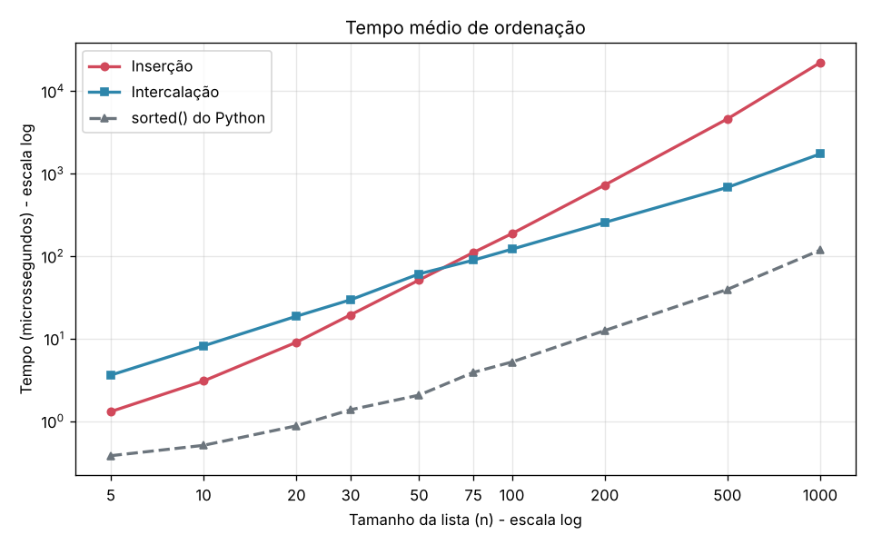
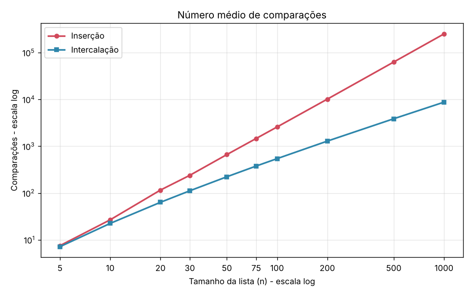

# Relatório — Inserção × Intercalação

## Como as medições foram feitas

- Tamanhos: n = 5, 10, 20, 30, 50, 75, 100, 200, 500 e 1000.
- **30 repetições** por tamanho (o mínimo pedido era 10). Os valores abaixo são a **média** das 30.
- Em cada repetição é sorteada uma lista aleatória de inteiros (semente fixa `2026`), e **a mesma lista** é ordenada pela inserção, pela intercalação e pelo `sorted()`. Assim os três sempre recebem exatamente a mesma entrada.
- Tempo medido com `time.perf_counter()`, usando as versões dos algoritmos **sem contador**, para que contar comparações não pese no tempo.
- Comparações contadas com versões separadas (`*_contando`), que executam a mesma lógica e somam 1 a cada comparação entre dois elementos da lista.
- Os números brutos (uma linha por algoritmo × n × repetição, 900 linhas) estão em `dados.csv`.

> Os tempos dependem da máquina. Se `python medir.py` for rodado em outro computador, os valores absolutos vão mudar, mas o formato das curvas e a região do ponto de virada devem ficar parecidos. As comparações não dependem da máquina: saem sempre iguais, porque a semente é fixa.

## Tabela de tempos (média, em microssegundos)

| n | Inserção | Intercalação | `sorted()` |
|---:|---:|---:|---:|
| 5 | 1,30 | 3,60 | 0,38 |
| 10 | 3,06 | 8,16 | 0,51 |
| 20 | 9,01 | 18,63 | 0,87 |
| 30 | 19,41 | 29,53 | 1,37 |
| 50 | 51,20 | 60,77 | 2,06 |
| **75** | **110,35** | **89,15** | 3,89 |
| 100 | 187,00 | 121,09 | 5,20 |
| 200 | 725,04 | 255,47 | 12,51 |
| 500 | 4 597,45 | 679,78 | 39,42 |
| 1000 | 22 087,62 | 1 729,53 | 117,97 |

## Tabela de comparações (média)

| n | Inserção | Intercalação | Inserção ÷ Intercalação |
|---:|---:|---:|---:|
| 5 | 7,5 | 7,1 | 1,1 |
| 10 | 26,7 | 22,4 | 1,2 |
| 20 | 115,4 | 63,2 | 1,8 |
| 30 | 238,5 | 111,5 | 2,1 |
| 50 | 661,0 | 222,0 | 3,0 |
| 75 | 1 463,3 | 376,5 | 3,9 |
| 100 | 2 571,6 | 541,4 | 4,7 |
| 200 | 10 107,9 | 1 282,9 | 7,9 |
| 500 | 62 732,8 | 3 853,0 | 16,3 |
| 1000 | 249 820,8 | 8 707,1 | 28,7 |

A inserção fica muito perto do valor teórico do caso médio, cerca de n²/4 (para n = 1000, 250 000). A intercalação fica perto de n·log₂n − n (para n = 1000, cerca de 8 970).

## Gráficos

Os dois eixos estão em escala logarítmica. Assim cabem na mesma figura tanto n = 5 quanto n = 1000, e a inclinação de cada reta mostra a complexidade: a inserção tem inclinação ~2 (quadrática), a intercalação ~1 (quase linear).

## Em que n a intercalação passa a ser mais rápida

**Na grade pedida, a intercalação passa a ser mais rápida a partir de n = 75** e continua mais rápida em todos os tamanhos maiores. Em n = 50 a inserção ainda ganha (51 µs contra 61 µs); em n = 75 a intercalação já ganha (89 µs contra 110 µs).

Rodei `medir.py` cinco vezes e o ponto de virada foi n = 75 em todas. Para localizar melhor, fiz uma medição extra (fora do CSV) com n de 5 em 5 entre 50 e 75: a virada real fica **por volta de n ≈ 55–60** nesta máquina.

## O gráfico de comparações e o de tempo dão o mesmo ponto de virada?

**Não.** Pelas comparações, a intercalação já faz menos comparações desde o menor tamanho testado (n = 5: 7,1 contra 7,5). Pelo tempo, ela só passa à frente perto de n = 60–75.

O motivo é que **o tempo não é só comparação**. O número de comparações mede um único tipo de operação, mas cada algoritmo faz outras coisas que custam caro em Python:

- **A intercalação tem muito custo "extra" por elemento.** A cada nível da recursão ela fatia a lista (`lista[:meio]`, `lista[meio:]`), o que cria cópias novas; monta uma lista de resultado com `append` e `extend`; e faz cerca de 2n chamadas de função recursivas. Em Python, chamada de função e criação de lista são operações relativamente lentas.
- **A inserção trabalha na própria lista.** Ela só desloca elementos com atribuições simples dentro de um laço, sem criar listas novas e sem recursão.

Ou seja, cada comparação da intercalação "vem acompanhada" de mais trabalho que cada comparação da inserção. Com n pequeno, a vantagem da intercalação em comparações é pequena (em n = 20 ela faz só 1,8× menos comparações) e não compensa esse custo fixo maior. Só quando n cresce e a diferença em comparações dispara (3,9× em n = 75, 28,7× em n = 1000) a complexidade O(n log n) vence o custo extra. Em notação assintótica, as constantes escondidas são diferentes: o O(n²) da inserção tem constante pequena e o O(n log n) da intercalação tem constante grande.

## Por que a comparação com `sorted()` não serve para decidir entre os dois

O `sorted()` foi de ~3× (inserção, n = 5) a quase 190× (inserção, n = 1000) mais rápido que os nossos algoritmos, mas isso não diz nada sobre qual dos dois escolher:

1. **É outro algoritmo.** O `sorted()` usa o Timsort, um híbrido de inserção e intercalação que aproveita trechos já ordenados. Ele não é nenhum dos dois métodos que estamos comparando.
2. **É escrito em C, não em Python.** A maior parte da vantagem vem de não passar pelo interpretador a cada operação. A comparação com ele mede "C contra Python", não "inserção contra intercalação". Ele é mais rápido que *os dois*, então serve no máximo como referência de escala, não como critério de desempate.
3. **Não dá para contar as comparações dele** com o mesmo método, então ele não entra no segundo gráfico.

A decisão entre inserção e intercalação tem que ser feita comparando as duas entre si, nas mesmas condições: mesma linguagem, mesmas listas, mesmo jeito de medir. Foi o que fizemos nas tabelas acima.

Curiosamente, o próprio Timsort confirma o resultado deste trabalho: para trechos pequenos (até 64 elementos) ele usa **inserção**, e só depois intercala os trechos ordenados.

## Um caso em que a inserção ainda seria a escolha adequada

**Listas quase ordenadas.** O custo da inserção é proporcional ao número de elementos fora do lugar, não a n². Se a lista já está quase em ordem, cada elemento anda pouquíssimo para trás e a inserção faz perto de n comparações, enquanto a intercalação sempre divide e intercala tudo, em ordem ou não.

Medição extra (fora do CSV) com n = 1000:

| Entrada | Inserção: comparações | Intercalação: comparações | Inserção: tempo | Intercalação: tempo |
|---|---:|---:|---:|---:|
| Já ordenada | 999 | 4 932 | ~77 µs | ~1 113 µs |
| Quase ordenada (10 pares trocados) | 1 009 | 4 940 | ~109 µs | ~965 µs |

Com lista aleatória, a inserção levou 22 000 µs em n = 1000; com lista quase ordenada, ~100 µs, cerca de **9× mais rápida que a intercalação**.

Um exemplo prático: um ranking que já está ordenado e recebe poucas atualizações (algumas pontuações mudam ou alguns itens novos chegam). Reordenar com inserção é quase linear.

Outros casos em que a inserção também é boa escolha:
- **Listas pequenas** (aqui, até ~50 elementos), como mostram as tabelas;
- **Dados chegando um por vez**, inserindo cada novo item na posição certa de uma lista já ordenada;
- **Pouca memória disponível**: a inserção ordena no lugar, com O(1) de memória extra, enquanto a intercalação precisa de O(n) de memória auxiliar.
